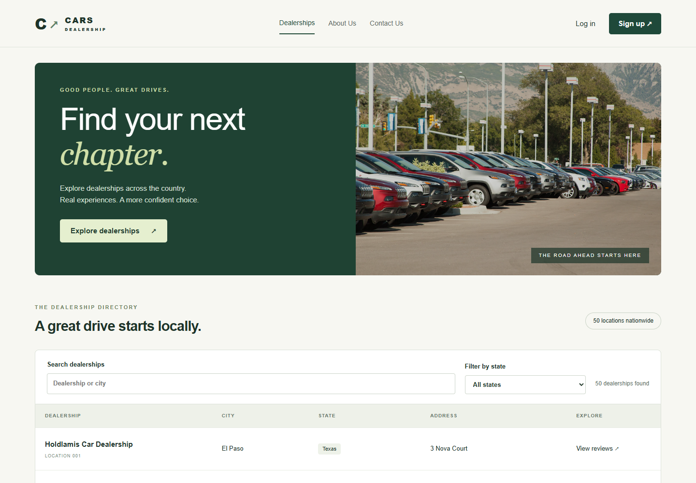

# Cars Dealership — Full-stack Developer Capstone

A responsive dealership directory and customer review application, completed from the IBM Developer Skills Network starter project.

**Project name:** Cars Dealership  
**Repository:** https://github.com/Tenma24/cars-dealership-capstone  
**Upstream:** https://github.com/ibm-developer-skills-network/xrwvm-fullstack_developer_capstone



## Features

- Browse 50 dealership branches; search by city/name and filter by state, including Kansas.
- Register with username, first name, last name, email and password; log in/out using Django sessions.
- Read dealership reviews; authenticated customers can post reviews with vehicle/purchase details.
- Classify review sentiment with a Flask/VADER microservice.
- Manage car makes, models and users through Django Admin.
- Responsive React interface, About Us and Contact Us pages.
- CSRF protection, hashed passwords, authenticated internal review writes, input validation and parameterized ORM/database queries.

## Architecture

Browser → Django/React → Node.js dealership service → MongoDB  
Django → Flask/VADER sentiment service  
Django → SQLite for users, sessions and the car catalog

The local convenience launcher explicitly selects a persistent JSON file adapter for the Node service when MongoDB is unavailable. The Docker Compose configuration uses real MongoDB. GitHub Actions also tests the Node service against MongoDB. This distinction is intentional and visible in `/health`; local file-mode results are not represented as MongoDB execution evidence.

## Run locally

Requires Python 3.12+, Node.js 22.12+ and npm.

```powershell
python -m venv .venv
.venv\Scripts\python -m pip install -r server/requirements.txt -r server/djangoapp/microservices/requirements.txt
.venv\Scripts\python scripts/run_local.py --setup
```

On Linux/macOS use `.venv/bin/python` instead. Open http://127.0.0.1:8000. The launcher generates random local credentials for `capstone` and administrator `root` in **LOCAL_ACCESS.txt**. This file, `.local-config.json`, databases and local secrets are ignored by Git. Do not upload them. Stop the launcher with Ctrl+C.

## Docker Compose

Copy `.env.example` to `.env` and replace both placeholder secrets with different random values. Then:

```sh
docker compose up --build
docker compose exec web python manage.py createsuperuser
```

This Compose configuration is for local HTTP development. SQLite and MongoDB use named volumes. Production requires `DJANGO_DEBUG=0`, a real hostname, HTTPS origins, durable storage and secrets. See [deployment instructions](docs/DEPLOYMENT.md).

## Tests

```sh
cd server
python manage.py test djangoapp
python -m unittest discover -s djangoapp/microservices -p 'test_*.py'
cd database
npm ci
npm test
cd ../frontend
npm ci
npm run build
npm run test:e2e
```

Browser tests require the local launcher to be running. On Windows they use installed Chrome; in CI Playwright installs Chromium. Test accounts and reviews are synthetic. Node tests use an isolated temporary file store unless `MONGODB_URL` is set. With MongoDB configured, tests add a synthetic review to the test database; use a disposable test database instance.

## Submission

See [SUBMISSION_RU.md](SUBMISSION_RU.md) for the task-by-task checklist and exact file links. `evidence/` holds actual local outputs and screenshots, not fabricated deployment evidence. Tasks 24–28 await the user's IBM Cloud / Skills Network environment. Browser screenshots produced by Playwright do not contain browser chrome; tasks 18–20 require a fresh manual capture including the address bar.

## Attribution

Original starter code, sample dealership/review/car data and bundled car/contact imagery: IBM Developer Skills Network, under the included [LICENSE](LICENSE). Team names, biographies and contact details are fictional educational examples. Portraits are illustrative Unsplash images loaded from images.unsplash.com; they do not identify actual employees. The interface remains in English to match the assignment.
